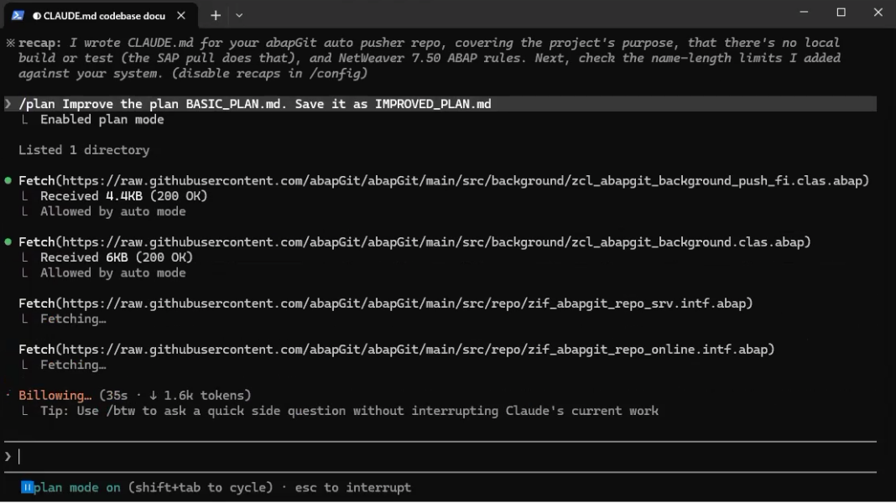
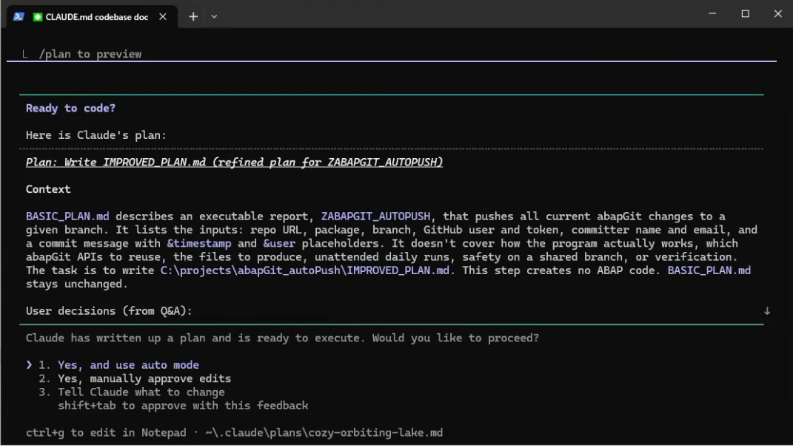

# abapGit Auto Pusher

The purpose of this abapGit project is two-fold

1. To provide teams with a utility that automatically syncs all of the recent developments to a given shared development branch. This helps ensure SAP development teams (and AI agents) get on the same diff/same page of latest code.
2. To offer an example of building ABAP off-stack with abapGit, leveraging AI agents. Note that this application was built entirely off-stack with no SAP system.

Overall - this can help introduce basic pipeline for agentic ABAP developments while also ameliorating the other issues of ABAP developers forgetting to regularly commit/sync/verify the ABAP code. This project by itself serves as a kind of basic working introduction on how off-stack ABAP developments can work their way up into an actual ABAP development system. Think of this repo like a lab assignment - the result is useful, but the process itself is worth demonstrating and explaining also. 

## Using the abapGit auto pusher

Requirements:
- You have another abapGit repo containing a large amount your your custom code  (e.g. your `ZSD`, `ZMM`, or other custom packages).
- You can push your commits using an API token
- Have the full [abapGit package](https://github.com/abapGit/abapGit) cloned into your system (and everything from STRUST is maintained ok). Note the initial se38 ZABAPGIT_STANDALONE client alone does not meet this requirement.
- Your syntax version may differ by system. Feel free to fork this repo, change the CLAUDE.md 

## Understanding how the abapGit autoPusher was built using Claude Code

### Step 0 : Git init and The baseline claude.md settings
Depending on your release level (whether older or newer) you can direct Claude to have a certain kind of ABAP Development style. For this repo - Claude was instructed to use syntax compatible with netweaver 7.5 (which should be representative of a mix of oldish and newish ABAP coding styles deployed today). See the [./CLAUDE.md](CLAUDE.md) file. This was generated using ```/init``` in this repo right after first authoring this README and starting the claude code session with ```claude``` cli command

### Step 1 : Drafting a basic plan

I wrote just a few lines in the [./BASIC_PLAN.md](BASIC_PLAN.md)

### Step 2 : Refining an improved plan with plan mode

With a claude code terminal open in the directory - I ran the following prompt with claude's plan mode.


 Note how the technical spec was improved in [./IMPROVED_PLAN.md](IMPROVED_PLAN.md)

### Step 3 : Your agent builds the report

Briefly after the new plan file is created - the agents asks if you would like to implement the changes. 


Saying yes here is how generated all the ABAP the in the `src` folder.

Page through each of the commits of this repo to see how the project came together. I also included an [export of my claude session output](./abapgitautopush_claude_session.md) you can review in case you don't have claude code installed. 

### Step 4 : Pull the abapGit auto pusher to your system
You just need to clone this repo into your SAP system

~OR~ you can experiment with your abapgit autopusher with your own directory and abapgit repo, your own copy of the basic prompts, your own run through of the plan - and pull that instead.

### Step 5 : Test then run the abapGit auto pusher daily
Once the abapGit auto pusher is available in your system, you can run it in SE38. Enter your other abapGit repo details in this autopusher report to save as a variant - then use as SM37 job to your hearts desire.

## Common pitfalls
Settings in claude.md can sometimes miss character-length restriction of ABAP object names. Typically when these errors come on activation/pull in the system, you can either edit manually in the system or do an offline code change to fix.

## Other uses

In an S/4 landscape - its common to have an N and N+1 landscape. Friction can occur as support and project teams make conflicting edits in both systems that end up as transport errors when the N an N+1 systems ultimately go to the same prod or pre-prod system.

With an abapgit autopusher - you can collect the code changes regularly from N and N+1 as separate branches. Merge conflicts on any given object between the two branches give you a pretty good hint of what you might wish to reconcile between the two systems before transport.

## Hey wait... didn't the abapGit client already have a background mode?

Actually yes! Details on that are documented here [here](https://docs.abapgit.org/user-guide/repo-settings/background-mode.html)

But wasn't this DIY project more fun? We also saved our API token in a more secure way with the obfuscated text input field rather than plain text like the standard abapGit background mode. Perhaps you could make your version even more secure in other ways?

Part of the utility in building it yourself too is to bring a foundation where your own GRC, Solman, Charm, or  change management tooling you have adjacent abapGit. There's other clever hooks you could add in how you format your commit messages to integrate Jira and other non-SAP change management tools to (ex: some specific CI/CD or test process kicks in on certain Jira issue mentioned). There other SAP-domain specific hooks like building test data or SAR files you could try here. There's all things you could try adding with insightful prompt. A standard background run of ZABAPGIT just by itself may not have as much flexibility.
